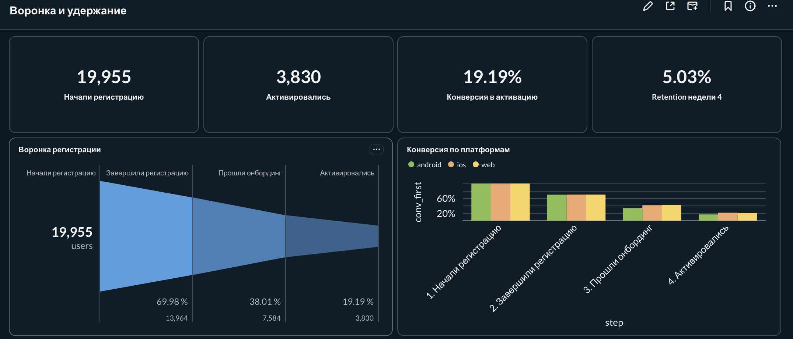
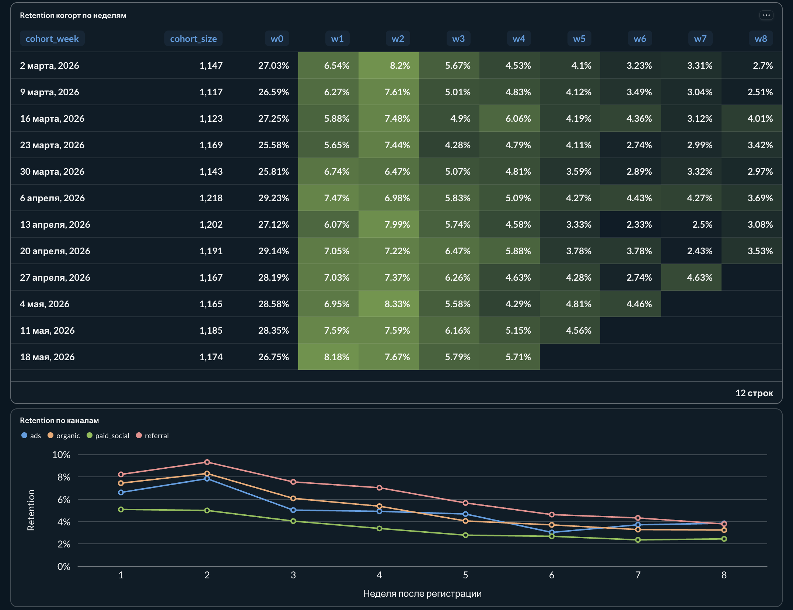
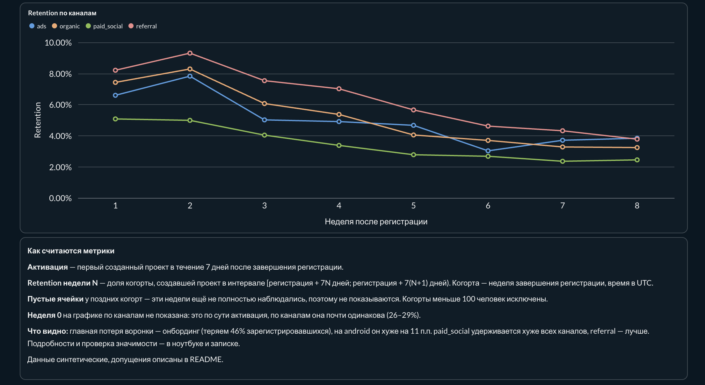
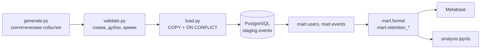

# Воронка регистрации и удержание

На каком этапе воронки теряются пользователи и какие сегменты хуже возвращаются в продукт.

Пайплайн от сырых логов до дашборда: генерация событий с известными эффектами и «грязью», валидация, загрузка в PostgreSQL, SQL-витрины воронки и когорт, статистическая проверка в Python, дашборд в Metabase и аналитическая записка.

**Стек:** Python (pandas, pandera, statsmodels), PostgreSQL 16, SQL, Metabase, Docker Compose, Make.

## Главное

- До активации доходят 19% начавших регистрацию. Крупнейшая потеря — онбординг: его не проходят 46% зарегистрировавшихся.
- На android онбординг проходят на 11.0 п.п. реже, чем на ios (95% ДИ [−12.7; −9.2]). Разница держится внутри каждого канала и страны.
- Каналы различаются не активацией (26–29% у всех), а возвратами: paid_social удерживается примерно в 1.5 раза хуже organic, referral лучше всех.
- A/B-тест онбординга на android с MDE 3 п.п. занял бы 17 недель, поэтому в записке предложены варианты быстрее.

Подробно: [memo.md](memo.md). Расчёты и проверки значимости: [notebooks/analysis.ipynb](notebooks/analysis.ipynb).





## Как устроено



```
src/
  generate.py          генератор событий (seed = 42, результат детерминирован)
  validate.py          проверки и очистка, карантин для брака
  load.py              идемпотентная загрузка в staging
sql/
  01_schema.sql        схемы и staging.events
  02_marts.sql         mart.users, mart.events
  03_funnel.sql        строгая воронка по сегментам
  04_retention.sql     недельный retention с учётом цензурирования
  checks/              проверка: подсчёт по событиям vs по пользователям
notebooks/analysis.ipynb
dashboard/
  queries.sql          запросы карточек дашборда
  screenshots/
memo.md                аналитическая записка
```

## Запуск

Нужны Docker, make и uv.

```bash
make setup    # .venv на Python 3.12, зависимости, .env из .env.example
make all      # база, генерация, валидация, загрузка, витрины
make notebook # перевыполнить ноутбук
```

Повторный `make all` безопасен: события загружаются по первичному ключу event_id, дублей не появится. Пересобрать базу с нуля: `make reset-db && make all`. Остановить контейнеры: `make down`.

База доступна на `localhost:5433`, логин и пароль в `.env`. Metabase открывается на http://localhost:3000. Сам дашборд хранится во внутренней базе Metabase, а не в репозитории, поэтому при первом запуске его нужно собрать заново: подключить PostgreSQL (хост `db`, порт `5432`, данные из `.env`) и создать карточки по запросам из `dashboard/queries.sql`.

## Данные и допущения

Данные синтетические. Эффекты заложены в генератор специально, чтобы проверить, что пайплайн и метрики их находят.

- 20 000 пользователей, регистрации равномерно за 12 недель с 2 марта 2026, наблюдение до 28 июня 2026.
- Каналы: organic 40%, paid_social 25%, ads 20%, referral 15%. Страны: RU 60%, KZ 20%, BY 10%, UZ 10%. Платформы: android 45%, ios 40%, web 15%.
- Воронка: регистрацию завершают 70%; онбординг на ios и web проходят 60%, на android 48%; первый проект в течение 7 дней создают 50% прошедших онбординг.
- Возвраты: у каждого пользователя своя вовлечённость eng ~ Beta(1.5, 3.5), в среднем 0.3. Вероятность вернуться на неделе k: c · (eng + (1 − eng) · exp(−(k − 1)/2)), где c зависит от канала. Новизна затухает, остаётся личный уровень, поэтому кривая выходит на плато.
- Грязь: 3% событий отправлены повторно с тем же event_id, у 1% сбиты часы клиента, 0.2% событий с невалидным именем. Версия 2.3.0 (около 11% событий) пишет client_ts в UTC+3 без зоны.

## Валидация

- Повторная отправка — это тот же event_id. Оставляем первую запись по server_ts, удалено 2 763 строки (2.89%). Два разных event_id у одного пользователя в одну секунду — это реальные действия, их не трогаем.
- Невалидные имена событий уходят в карантин с причиной, а не удаляются молча (205 строк).
- Время события = server_ts в UTC. Медианное расхождение client_ts и server_ts у версии 2.3.0 ровно +3 часа, у остальных версий 0.
- Валидация проверялась на копии с намеренно испорченными данными: пустой event_id, пропавшая колонка, подменённая платформа пользователя.

## Определения

- **Активация** — первый проект в течение 7 дней после завершения регистрации. Окно фиксировано и одинаково для всех когорт.
- **Активный пользователь** — создал проект за период; открытие приложения не считается.
- **Когорта** — неделя завершения регистрации (понедельник, UTC). Неделя считается явно через `AT TIME ZONE 'UTC'`, чтобы результат не зависел от таймзоны сессии.
- **Retention недели N** — доля когорты с ключевым действием в [регистрация + 7N дней; регистрация + 7(N+1) дней). Ячейка показывается, только если неделя полностью наблюдалась для всей когорты; когорты меньше 100 человек исключены.
- Воронка строгая: шаг засчитывается, только если пройден предыдущий. Все метрики по уникальным пользователям.

## Вопросы, которые стоит себе задать

**Чем retention отличается от повторной покупки?** Retention — возврат к ключевому действию в конкретный период относительно начала когорты, это кривая во времени. Повторная покупка — частный денежный исход без привязки к периодам. Можно регулярно возвращаться и ничего не покупать, а можно купить дважды в первый день и уйти.

**Что будет, если считать по событиям, а не по пользователям?** Активные пользователи весят больше остальных, ретраи напрямую раздувают числа. В этом проекте конверсия в активацию по событиям выходит 87% вместо 27% (`sql/checks/events_vs_users.sql`).

**Почему нельзя сравнивать когорты с разной длительностью наблюдения?** У свежей когорты просто не было времени вернуться на поздних неделях, поэтому её показатели механически ниже. Сравнивать можно только на одинаковом «возрасте» когорты и только полностью наблюдаемые недели. Поэтому матрица retention треугольная.

## Ограничения

- Синтетические данные: реальная картина сложнее.
- Возвраты в генераторе привязаны к активации, а retention считается от регистрации. Из-за этого 2-я неделя у большинства когорт выше 1-й.
- После 8-й недели остаётся мало когорт, различия между каналами там в пределах шума.
